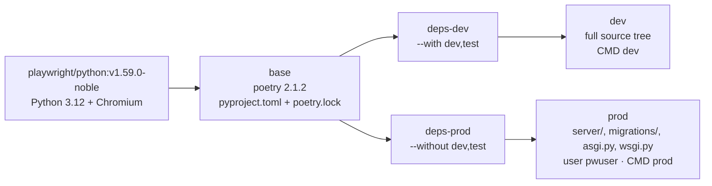
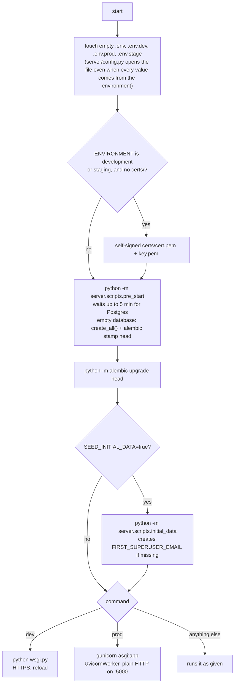

# Docker

How the backend image is built and what it does on every start. The image is
meant to be run from [USPolis-Admin](https://github.com/PCS-Poli-USP/USPolis-Admin),
whose `docker-compose.yml` supplies the database, Redis and every environment
variable. Its `docs/DOCKER.md` covers the stack as a whole.

## Files

| File | What it does |
|------|--------------|
| [`../Dockerfile`](../Dockerfile) | Builds the image, with a `dev` and a `prod` target |
| [`entrypoint.sh`](entrypoint.sh) | Runs on every container start: database setup, then the server |
| [`../.dockerignore`](../.dockerignore) | Keeps secrets (`.env*`, `certs/`), caches, logs and docs out of the build |

## Image stages



- **Why Playwright's image:** the JupiterWeb crawler
  (`server/services/jupiter_crawler/`) drives a headless Chromium in
  production, not only in tests. Keep the image tag in step with the
  `playwright` version in `poetry.lock`.
- **Dependencies before code:** `pyproject.toml` and `poetry.lock` are copied
  on their own first, so a code-only change reuses the cached dependency layer.
  Poetry installs straight into the system Python (`POETRY_VIRTUALENVS_CREATE=false`).
- **`dev`** copies the whole repository, but in Compose the source is mounted
  over it, so edits apply without a rebuild.
- **`prod`** copies only what the app needs and runs as `pwuser`, the non-root
  user that already owns the image's Chromium install. `/app/logs` is created
  and owned by `pwuser`, because `server/logger.py` opens its log file there on
  import: without it, the app fails to start.

## What `entrypoint.sh` does



Every start migrates the database. A failing migration stops the container
before the server starts, so with `restart: unless-stopped` it keeps
restarting, and the error is in `docker compose logs backend`.

The last branch runs any other command after the same setup, for example
`docker compose run --rm backend python -m alembic history`.

## Environment variables read here

Everything else (`DATABASE_URI`, `REDIS_URL`, ...) goes straight to the app.

| Variable | Default | Effect |
|----------|---------|--------|
| `ENVIRONMENT` | `development` | `development`/`staging` generate the dev certificate |
| `SEED_INITIAL_DATA` | `false` | `true` creates the first superuser |
| `GUNICORN_FORWARDED_ALLOW_IPS` | `127.0.0.1` | the only addresses whose `X-Forwarded-For` is trusted; Compose sets it to the nginx container. Never `*`: clients could fake their IP and dodge the rate limit |
| `GUNICORN_WORKERS` | `4` | gunicorn workers (`prod`) |
| `PORT` | `5000` | port gunicorn listens on (`prod`) |

## Building it alone

From this repository's root:

```bash
docker build --target prod -t uspolis-backend:prod .
docker build --target dev -t uspolis-backend:dev .
```

Running it alone also needs a reachable Postgres and Redis and the variables
above, which is why USPolis-Admin's Compose setup is the normal way in.
